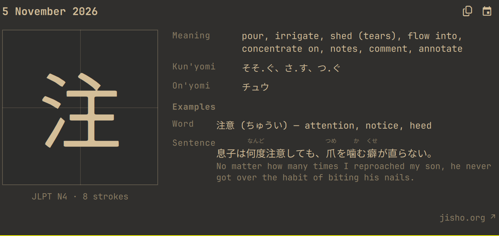

# Kanji of the Day for Omarchy

A daily kanji for the Omarchy bar, picked deterministically from Jisho. The
bar shows `KotD: 日`; clicking it opens a meishi-shaped card with the kanji, a
2×2 writing guide, meanings, readings, an example word and a Japanese example
sentence with furigana.



No API key. Data comes from Jisho.org.

## Requirements

- Omarchy Quattro.
- `curl` for Jisho requests.
- `wl-copy` for the copy button.
- `xdg-open` for the Jisho link.
- Network access to Jisho.org.

## Install

```sh
omarchy plugin add https://github.com/alvmarrod/omarchy-kanji-of-the-day.git --enable
```

The widget lands in the bar's center section. Move it with:

```sh
omarchy bar move io.github.alvmarrod.kanji-of-the-day --section right
```

Click the bar label to open the card.

## Use

- The bar always shows the latest available day: `KotD: <kanji>`.
- The card shows:
  - the kanji over a 2×2 writing guide, with its JLPT level and stroke count;
  - meaning, kun'yomi and on'yomi;
  - an `Examples` block with a word and a sentence; the word carries its
    reading and meaning, the sentence is Japanese with furigana plus its
    English translation.
- The copy icon next to the calendar copies the kanji to the clipboard.
- `jisho.org ↗` at the bottom of the card opens the kanji's Jisho page.
- Panel text is scaled 15% above the theme's panel size; the large kanji keeps
  its size.
- The calendar icon opens a picker for the current year. Days after today are
  disabled, and months after the current month cannot be reached. Picking an
  earlier day shows that day's kanji in the card; the bar keeps the latest
  available day.
- Middle-click the bar label, or run `refresh`, to fetch again. Keyboard:
  `r` refreshes, `t` jumps back to today, `Esc` closes.
- If today's fetch fails, the bar keeps the last available kanji and the open
  card shows a warning with a `Retry` button.

Useful commands:

```sh
omarchy-shell io.github.alvmarrod.kanji-of-the-day toggle
omarchy-shell io.github.alvmarrod.kanji-of-the-day refresh
```

## How the daily pick works

The pick is seeded only by the local calendar date, `YYYY-MM-DD`:

1. Draw the JLPT level, `1..5` → N1…N5.
2. Fetch Jisho's search page for that level and read the total result count.
3. Draw the result index, `1..count`.
4. Jisho paginates 20 results per page, so fetch the page holding that index.

Same date → same level and index for everyone. The result is cached for the
day. The selection depends on Jisho's live result count and order: if Jisho's
list changes, the same date can map to a different kanji. Picking an earlier
day recomputes against Jisho's current list, not a historical snapshot.

## Data and requests

- Kanji, readings, meanings and JLPT levels: Jisho's kanji search.
- Example word: Jisho's word search JSON API, first common multi-character word
  containing the kanji.
- Example sentence: Jisho's sentence search for that word. The shortest of the
  first few results that actually contains the word is used; up to three word
  candidates are tried.
- Furigana comes from the furigana annotations on Jisho's sentence results.

A new day costs 3–6 requests. Every fetched day, including dates picked from
the calendar, is cached for the year. Reopening, revisiting the same date, or
restarting the shell does not fetch it again.

## Cache

Fetched kanji are stored in one file per year inside the installed plugin:

```
~/.config/omarchy/plugins/io.github.alvmarrod.kanji-of-the-day/data/2026.json
```

The file keeps every day fetched during the year and the latest date, which
the bar uses as its fallback. The directory is mode 0700, the file 0600, and
writes are atomic. On startup and when a new year begins, older year files are
deleted; the new year starts empty. Removing the plugin removes the cache with
it. `omarchy plugin update` leaves the untracked data folder alone. The
development `rsync` below excludes `data/` so it does not wipe the cache.

Writes are deferred while the card is open and flushed when it closes: the
shell watches plugin directories and reloads a plugin when a file inside it
changes, so writing mid-session would close the card under the user.

The previous `~/.local/state/omarchy/kanji-of-the-day` file is no longer used;
delete it if it is still around.

## Remove

```sh
omarchy plugin remove io.github.alvmarrod.kanji-of-the-day --yes
```

The cache lives inside the plugin folder and is removed with it.

## Develop

```sh
node --test test/*.test.js
qmllint -I /usr/share/omarchy/shell BarWidget.qml Panel.qml RubyText.qml
omarchy plugin validate "$PWD"
```

To test changes in the running shell, sync into the installed plugin and
restart:

```sh
rsync -a --delete --exclude .git --exclude data ./ ~/.config/omarchy/plugins/io.github.alvmarrod.kanji-of-the-day/
omarchy restart shell
```

`Kanji.js`, `Calendar.js` and `Store.js` are pure modules covered by Node
tests, including the golden date seed, the Jisho HTML/JSON parsers, furigana
segmentation and the current-year calendar rules.

## Limitations

- Jisho is scraped from a plugin; there is no stable public kanji API. An HTML
  or JSON change on Jisho can break parsing.
- Jisho's kanji search shows 20 results per page; the page size is part of the
  selection math.
- The English example sentence is the translation Jisho provides, which is
  sometimes machine-generated and awkward.
- Only the current year is selectable, and never a future date.

## Changelog

See [CHANGELOG.md](CHANGELOG.md).

## License

MIT. See [LICENSE](LICENSE).
